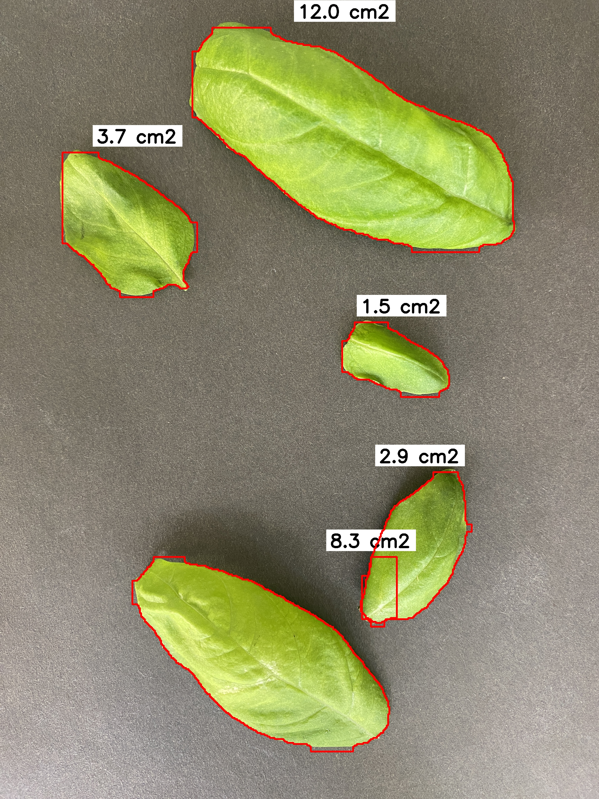
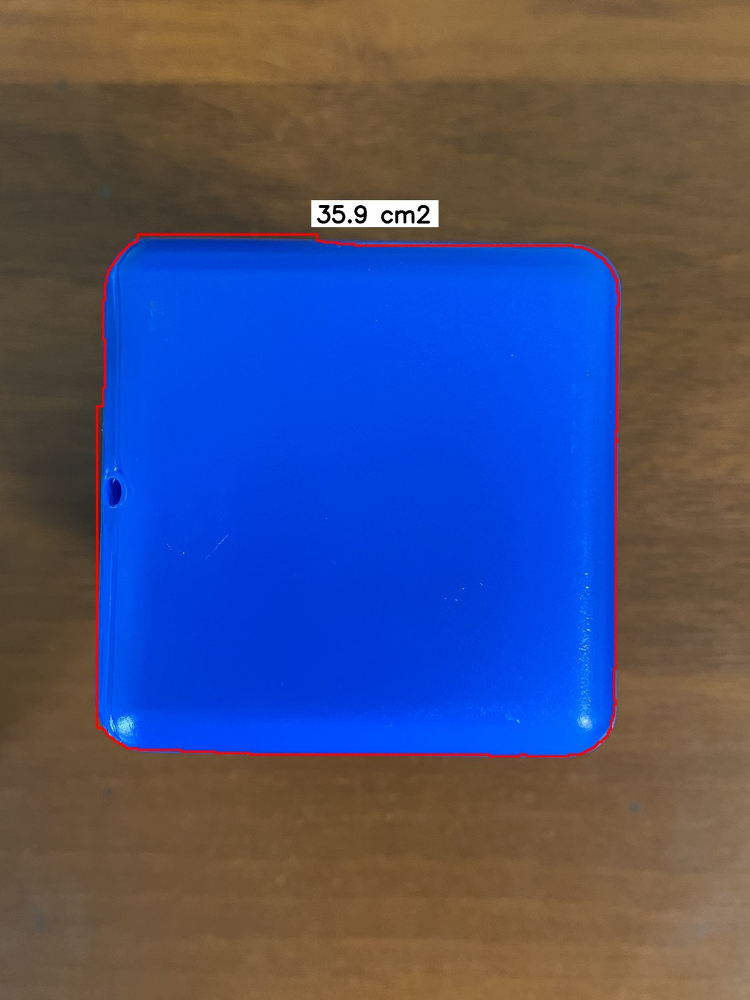

<div align="center">

# Computer Vision · Basil Leaf Area

### From leaf segmentation to distance-aware projected area

Two research stages: **Ocimum basilicum** at a fixed camera distance and a model system at varying distances.

**Python · YOLO-seg · OpenCV · CVAT · ESP-8266 · HC-SR04**

[Русский](README.md) · [Methodology (RU)](docs/methodology.md) · [Sources and provenance (RU)](docs/provenance.md)

</div>

## Research

**I am G. A. Potapov, ITMO University.**

As a plant grows toward the camera, image scale changes. In this project, I combine instance segmentation with spatial calibration to estimate visible projected area.

1. **Basil leaves:** segmentation and pixel-to-cm² conversion at a fixed distance, using a calibrated 13 × 10 cm field of view.
2. **Model system:** a separately trained model and a microcontroller setup for investigating distance compensation. The abstracts describe an ESP-8266 and HC-SR04 ultrasonic sensor. Long-term validation on growing basil remains future work.

I trained **YOLO11-seg** for this research, as described in both abstracts. Archived notebooks and training arguments retain references to YOLOv8m-seg ; I preserve these files as historical materials. I measured the distance with the ESP-8266 / HC-SR04 setup, used it to determine the physical camera field of view, and manually entered its dimensions in the notebook. I then multiplied the fraction of image pixels occupied by the mask by the field-of-view area. The two stages are separate training experiments; sequential fine-tuning of a single model is not established.

## Publications

I published two abstracts based on this work:

- **G. A. Potapov.** Automatic measurement of basil leaf surface area using image segmentation with YOLO11. Scientific supervisor: D. P. Kanaikin. XV ITMO Congress of Young Scientists, 2026. [Publication record](https://kmu.itmo.ru/digests/article/16798) · [PDF hosted by ITMO](https://kmu.itmo.ru/file/download/application/60120).
- **G. A. Potapov.** Model system for measuring the leaf surface area of growing basil based on YOLO11. Proceedings of the 68th All-Russian Scientific Conference of MIPT, March 30–April 4, 2026. Biological and Medical Physics. Moscow: Fizmatkniga, 2026, pp. 127–128. [Conference proceedings, PDF](docs/publications/mipt-2026-biological-medical-physics.pdf#page=127).

Both PDFs discuss the baseline and distance-aware approach. The first abstract is listed in the electronic proceedings of the XV ITMO Congress of Young Scientists (2026). I verified the second abstract in the MIPT conference proceedings, pp. 127–128.

## Examples

| Basil: contours and area | Model system: archived prediction |
|:--:|:--:|
|  |  |

These are illustrations from the training data, not independent validation. Publication images are resized and have EXIF removed.

## Results

Mask metrics from the last recorded CSV row:

| Metric | Basil, epoch 17 | Model system, epoch 31 |
|:--|--:|--:|
| Precision | 1.00000 | 0.99599 |
| Recall | 0.99969 | 1.00000 |
| mAP@0.50 | 0.99500 | 0.99500 |
| mAP@0.50:0.95 | 0.98614 | 0.97986 |

Sources: [basil CSV](reports/basil/results.csv), [cubes CSV](reports/cubes/results.csv). I have not verified which epochs correspond to the best checkpoints. mAP measures segmentation quality; it does not quantify area error in cm². Independent area MAE/RMSE and numerical distance-compensation error are unavailable.

I used **YOLO11-seg** in this research. Archived file settings: imgsz=640, batch=8, patience=200, planned epochs=25/50. The MIPT abstract reports YOLO11-seg, 17 epochs, batch=16 and patience=50.

## Data

Local inventory of annotation files with matching images:

| Dataset | Split | Images | Annotated objects |
|:--|:--|--:|--:|
| Basil (`Leaf`) | train | 460 | 1041 |
| Basil (`Leaf`) | validation | 188 | 426 |
| Model system (`Area`) | train | 86 | 116 |
| Model system (`Area`) | validation | 9 | 12 |

This inventory does not establish the dataset composition at publication time; the abstracts mention 500 basil images. I store the full datasets and model weights separately. I do not claim an independent test split here. Scene/plant-level separation needs verification.

## Run

From the repository root, using Python 3.11–3.13:

```bash
python3 -m venv .venv
source .venv/bin/activate
python -m pip install -r requirements.txt
python predict.py examples/basil.jpg --weights weights/basil-best.pt \
  --field-width 13 --field-height 10 --output outputs/basil.jpg
```

Supply custom trained weights. Width and height specify the entire field of view in centimetres at the object plane. Outputs are an annotated image and JSON with per-instance projected areas. Default device is CPU; Apple Silicon users may specify `--device mps`.

Optional `--reference-distance` and `--distance` (both in cm) apply `(d/d0)²` to the calibrated area. This newly prepared geometry example assumes fixed optics and a flat object perpendicular to the optical axis. It takes manually supplied distances; it is not recovered firmware or an automatic sensor integration. Use measured calibration values for your setup.

For training, arrange separate YOLO-seg datasets under `data/basil` and `data/cubes`, each containing `train/{images,labels}` and `validation/{images,labels}`. Set an absolute dataset `path` in the relevant YAML, since relative path resolution depends on Ultralytics settings.

```bash
python train.py --stage basil --data configs/basil.yaml --model /path/to/yolo11-seg.pt
python train.py --stage cubes --data configs/cubes.yaml --model /path/to/yolo11-seg.pt
```

I explicitly select YOLO11-seg initial weights through the required `--model` argument. `/path/to/yolo11-seg.pt` is a placeholder for the chosen checkpoint; it does not specify a verified historical model size. I prepared new entry-point scripts for this package. I have not run full neural inference or retraining in the packaging environment.

## Limits and provenance

Only visible projected areas are measured. Occlusion, curved leaves, camera changes and objects at different depths limit interpretation. A sum of mask areas can double-count overlapping projections.

I included original notebooks, CSV logs and training arguments with portable paths. I could not find firmware, wiring diagrams or synchronized distance records in the available source files. I excluded the original CVAT checkout and third-party COCO converter; converter credit belongs to [Koldim2001/COCO_to_YOLOv8](https://github.com/Koldim2001/COCO_to_YOLOv8). I have not yet selected a license for my code, images, data or weights.
