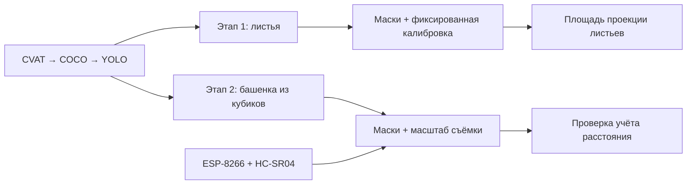

<div align="center">

# Computer Vision · Basil Leaf Area

### От сегментации листа к измерению площади с учётом расстояния

Компьютерное зрение для исследования роста **Ocimum basilicum**.
Два этапа работы: листья при фиксированной дистанции и модельная система при изменении расстояния.

**Python · YOLO-seg · OpenCV · CVAT · ESP-8266 · HC-SR04**

[Два этапа](#два-этапа-исследования) · [Тезисы](#тезисы) · [Результаты](#результаты) · [Запуск](#быстрый-запуск) · [Методика](docs/methodology.md) · [English](README.en.md)

</div>

---

## Задача

Разработать систему автоматического измерения площади листьев базилика по фотографиям с использованием YOLO11 и компенсацией изменения расстояния между камерой и объектом.

**Автор: Г. А. Потапов, Национальный исследовательский университет ИТМО.**

В этом проекте я объединил два этапа своего исследования и материалы двух тезисов. Для сегментации я обучал **YOLO11-seg**. Подробности я описал в [методике](docs/methodology.md).

## Два этапа исследования

| Этап | Объект и задача | Что представлено |
|:--|:--|:--|
| 1. Площадь листа | Базилик, фиксированное расстояние, поле зрения 13 × 10 см | Обучение, маски листьев, пересчёт пикселей в см² |
| 2. Учёт расстояния | Башенка из кубиков как модель изменения высоты растения | Отдельное обучение на кубиках, примеры площади при разных масштабах; аппаратная система описана в тезисах |

На втором этапе я собрал микроконтроллерную установку. В тезисах указаны **ESP-8266 и ультразвуковой датчик HC-SR04**. Компенсацию расстояния я проверял на модельном объекте с известной геометрией. Долгосрочное измерение растущего базилика остаётся следующим этапом исследования.



Схема показывает исследовательский подход. В репозиторий я включил файлы обучения и измерения по заданной калибровке; прошивку и код автоматического чтения дистанции в доступных исходниках я не нашёл.

## Тезисы

По результатам работы я опубликовал два текста тезисов:

1. **Потапов Г. А.** «Модельная система измерения площади листовой поверхности растущего базилика на базе YOLO11». [PDF](docs/publications/basil-model-system.pdf).
2. **Потапов Г. А.** «Модельная система адаптивного измерения площади листовой поверхности растущего базилика на базе YOLO11». [PDF](docs/publications/basil-adaptive-system.pdf).

Оба текста описывают базовый метод и развитие с компенсацией расстояния. Я привожу оба текста вместе, поскольку каждый из них затрагивает оба этапа. Выходные данные конференций и ссылки на записи публикаций в этих PDF отсутствуют.

## Примеры работы

| Листья базилика: контуры и площадь | Кубики: сохранённый результат |
|:--:|:--:|
|  |  |

Для иллюстраций я выбрал сохранённые результаты своих экспериментов на обучающей выборке. Они показывают визуализацию, а не независимую проверку точности. Файлы для запуска демо: [базилик](examples/basil.jpg), [кубики](examples/cubes.jpg). Изображения уменьшены для публикации; заново запущенное демо может дать другой результат.

## Результаты

Метрики **масок** из последней сохранённой строки каждого журнала:

| Метрика | Базилик, эпоха 17 | Кубики, эпоха 31 |
|:--|--:|--:|
| Precision | 1,00000 | 0,99599 |
| Recall | 0,99969 | 1,00000 |
| mAP@0.50 | 0,99500 | 0,99500 |
| mAP@0.50:0.95 | 0,98614 | 0,97986 |

Источники: [журнал базилика](reports/basil/results.csv), [журнал кубиков](reports/cubes/results.csv). Я не приписываю эти строки checkpoint `best.pt`: его связь с конкретной эпохой я отдельно не проверял.

**mAP не является точностью измерения площади в см².** Независимые MAE/RMSE площади и численную ошибку компенсации расстояния я здесь не привожу: в доступных материалах этих результатов нет.

В исследовании я обучал **YOLO11-seg**. Параметры архивных файлов: imgsz=640, batch=8, patience=200; запланировано 25 эпох для базилика и 50 для кубиков. В тезисах приведены другие параметры — см. [разбор источников](docs/methodology.md).

## Данные

Инвентаризация доступных файлов YOLO-разметки:

| Объект | Выборка | Файлы разметки с парными изображениями | Объекты |
|:--|:--|--:|--:|
| Базилик, `Leaf` | train | 460 | 1041 |
| Базилик, `Leaf` | validation | 188 | 426 |
| Кубики, `Area` | train | 86 | 116 |
| Кубики, `Area` | validation | 9 | 12 |

Это состояние локальных папок, а не подтверждение состава датасета на момент публикации; в тезисах указаны 500 изображений базилика. Полные датасеты и веса я храню отдельно. Разделение по растениям и сериям съёмки требует проверки; независимый test я в этом пакете не заявляю.

## Быстрый запуск

Из корня проекта, в окружении Python 3.11–3.13:

```bash
python3 -m venv .venv
source .venv/bin/activate
python -m pip install -r requirements.txt
```

Поместите обученные веса в `weights/basil-best.pt` и `weights/cubes-best.pt`. Стандартные pretrained-веса не заменяют модели, обученные на листьях и кубиках.

```bash
python predict.py examples/basil.jpg --weights weights/basil-best.pt \
  --field-width 13 --field-height 10 --output outputs/basil.jpg
```

`--field-width` и `--field-height` — размеры **всего поля зрения** в плоскости объекта, в см. Для иной съёмки задайте свою калибровку. Результат: изображение с контурами и JSON с площадью каждой маски, числом объектов и суммой площадей проекций.

### Пример расчёта по расстоянию

Для геометрической демонстрации можно указать дистанцию вручную:

```bash
python predict.py examples/cubes.jpg --weights weights/cubes-best.pt \
  --field-width 11.5 --field-height 8.9024 \
  --reference-distance 30 --distance 25 --output outputs/cubes.jpg
```

**30 и 25 см — условные значения для примера синтаксиса**, а не дистанции исходного снимка. Ширина и высота приведены из одной ячейки исходного ноутбука. Для измерения замените все четыре значения согласованной калибровкой своей установки. Демо применяет `(d/d0)²` при неизменной оптике и плоском объекте. Этот пример расчёта я добавил при оформлении проекта; автоматическое подключение к датчику в нём не реализовано.

По умолчанию `device=cpu`, `conf=0.25`, `imgsz=640`. Для Apple Silicon можно передать `--device mps`. Скрипты я подготовил при оформлении; полноценный прогон с нейросетью в текущем окружении я не выполнял.

### Повторное обучение

Разложите данные отдельно для каждого этапа: `data/basil/{train,validation}/{images,labels}` и `data/cubes/{train,validation}/{images,labels}`. В YAML используйте абсолютный `path` к своей папке данных: разрешение относительного `path` зависит от настроек Ultralytics.

```bash
python train.py --stage basil --data configs/basil.yaml
python train.py --stage cubes --data configs/cubes.yaml
```

Для обучения YOLO11 передайте `--model` с именем или путём к нужным начальным весам YOLO11-seg. Без этого параметра обе команды используют архивную настройку `yolov8m-seg.pt`, которое при первом запуске может потребовать загрузки из интернета. Число эпох по умолчанию соответствует сохранённым параметрам запуска, а не длине завершившихся CSV. Повторное обучение не гарантирует идентичные метрики.

## Структура

```text
basil-leaf-area/
├── predict.py              # Маски, площадь, изображение и JSON
├── calibration.py          # Расчёт площади проекции
├── train.py                # Отдельный запуск для basil / cubes
├── configs/                # Два датасета
├── notebooks/              # Исторические ноутбуки с относительными путями
├── examples/               # Уменьшенные примеры без EXIF
├── reports/                # CSV, параметры и инвентаризация
├── docs/publications/      # Два тезиса
├── docs/methodology.md     # Методика и расхождения источников
└── weights/                # Веса размещаются локально
```

## Ограничения и развитие

- Измеряется видимая проекция: перекрытые и изогнутые части листа не восстанавливаются.
- Одного расстояния недостаточно для точной площади объектов, лежащих в разных плоскостях; требуется проверка геометрии установки.
- Исходники прошивки, схема подключения и синхронные записи расстояния в доступных материалах отсутствуют.
- Следующий шаг — валидация на растущем базилике и оценка ошибки площади на независимой выборке.

## Инструменты и авторство

Ultralytics YOLO-seg, OpenCV, CVAT; конвертер COCO → YOLO — **Koldim2001/COCO_to_YOLOv8**. Его исходники и копию CVAT я не включал в пакет. [Происхождение материалов и лицензирование](docs/provenance.md).

Лицензию для своего кода, данных, иллюстраций и весов я пока не выбрал. Пакет я подготовил для загрузки на GitHub.
