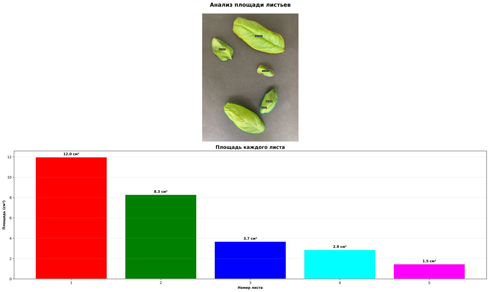
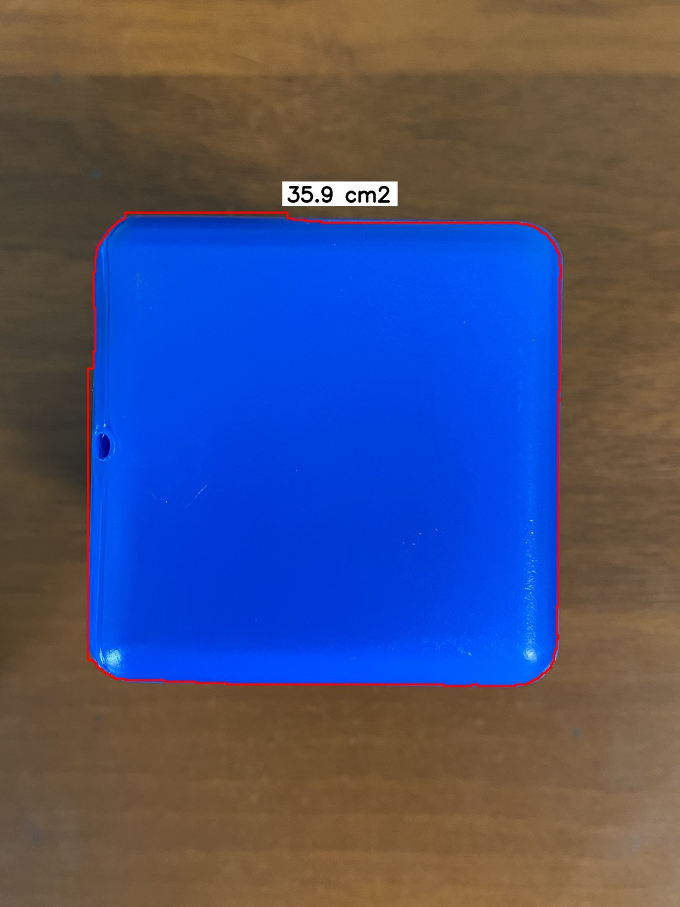

<div align="center">

# Computer Vision · Basil Leaf Area

### From leaf segmentation to distance-aware projected area

Two research stages: **Ocimum basilicum** at a fixed camera distance and a cube tower as a geometric model at varying distances.

**Python · YOLO-seg · OpenCV · CVAT · ESP-8266 · HC-SR04**

[Русский](README.md) · [Methodology (RU)](docs/methodology.md) · [Sources and provenance (RU)](docs/provenance.md)

</div>

## Research

**Author: G. A. Potapov · ITMO University.**

As a plant grows toward the camera, image scale changes. This project combines instance segmentation with spatial calibration to estimate visible projected area.

1. **Basil leaves:** segmentation and pixel-to-cm² conversion at a fixed distance, using a calibrated 13 × 10 cm field of view.
2. **Cube tower:** a separately trained model and a microcontroller setup for investigating distance compensation. The abstracts describe an ESP-8266 and HC-SR04 ultrasonic sensor. Long-term validation on growing basil remains future work.

The author confirms that **YOLO11-seg** was trained for this research, consistent with both abstracts. Archived notebooks and training arguments retain references to YOLOv8m-seg and are preserved as historical materials. The two stages are separate training experiments; sequential fine-tuning of a single model is not established.

## Publications

Two author-provided abstracts, described by the author as published:

- [Model system for measuring the leaf surface area of growing basil based on YOLO11](docs/publications/basil-model-system.pdf).
- [Model system for adaptive measurement of the leaf surface area of growing basil based on YOLO11](docs/publications/basil-adaptive-system.pdf).

Both PDFs discuss the baseline and distance-aware approach. Conference names, dates and publication record links are not present in the supplied files.

## Examples

| Basil: archived area report | Cube tower: archived prediction |
|:--:|:--:|
|  |  |

These are illustrations from the training data, not independent validation. Publication images are resized and have EXIF removed.

## Results

Mask metrics from the last recorded CSV row:

| Metric | Basil, epoch 17 | Cubes, epoch 31 |
|:--|--:|--:|
| Precision | 1.00000 | 0.99599 |
| Recall | 0.99969 | 1.00000 |
| mAP@0.50 | 0.99500 | 0.99500 |
| mAP@0.50:0.95 | 0.98614 | 0.97986 |

Sources: [basil CSV](reports/basil/results.csv), [cubes CSV](reports/cubes/results.csv). These rows have not been linked to the best checkpoints. mAP measures segmentation quality; it does not quantify area error in cm². Independent area MAE/RMSE and numerical distance-compensation error are unavailable.

The research model is **YOLO11-seg**, as confirmed by the author. Archived file settings: imgsz=640, batch=8, patience=200, planned epochs=25/50. The abstracts instead describe YOLO11-seg, 17 epochs, batch=16 and patience=50.

## Data

Local inventory of annotation files with matching images:

| Dataset | Split | Images | Annotated objects |
|:--|:--|--:|--:|
| Basil (`Leaf`) | train | 460 | 1041 |
| Basil (`Leaf`) | validation | 188 | 426 |
| Cubes (`Area`) | train | 86 | 116 |
| Cubes (`Area`) | validation | 9 | 12 |

This inventory does not establish the dataset composition at publication time; the abstracts mention 500 basil images. Full datasets and model weights are stored separately. No independent test split is claimed. Scene/plant-level separation needs verification.

## Run

From the repository root, using Python 3.11–3.13:

```bash
python3 -m venv .venv
source .venv/bin/activate
python -m pip install -r requirements.txt
python predict.py examples/basil.jpg --weights weights/basil-best.pt \
  --field-width 13 --field-height 10 --output outputs/basil.jpg
```

Supply custom trained weights. Width and height specify the entire field of view in centimetres at the object plane. Outputs are an annotated image and JSON with per-instance projected areas. Default device is CPU; Apple Silicon users may specify `--device mps`.

Optional `--reference-distance` and `--distance` (both in cm) apply `(d/d0)²` to the calibrated area. This newly prepared geometry example assumes fixed optics and a flat object perpendicular to the optical axis. It takes manually supplied distances; it is not recovered firmware or an automatic sensor integration. Use measured calibration values for your setup.

For training, arrange separate YOLO-seg datasets under `data/basil` and `data/cubes`, each containing `train/{images,labels}` and `validation/{images,labels}`. Set an absolute dataset `path` in the relevant YAML, since relative path resolution depends on Ultralytics settings.

```bash
python train.py --stage basil --data configs/basil.yaml
python train.py --stage cubes --data configs/cubes.yaml
```

For YOLO11 training, pass `--model` with the required YOLO11-seg initial weights. Without that option, the scripts retain the archived `yolov8m-seg.pt` default; an initial download may be required. New entry-point scripts were prepared for this package. Full neural inference and retraining have not been executed in the packaging environment.

## Limits and provenance

Only visible projected areas are measured. Occlusion, curved leaves, camera changes and objects at different depths limit interpretation. A sum of mask areas can double-count overlapping projections.

Original notebooks, CSV logs and sanitized training arguments are included. Firmware, wiring diagrams and synchronized distance records were not found. The original CVAT checkout and third-party COCO converter were excluded; converter credit belongs to [Koldim2001/COCO_to_YOLOv8](https://github.com/Koldim2001/COCO_to_YOLOv8). No license has yet been selected for the author's code, images, data or weights.
